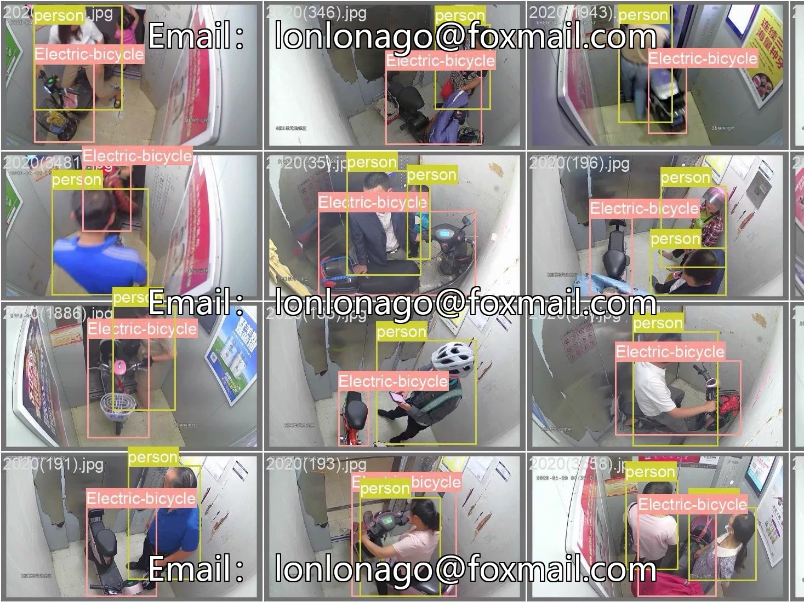

# Intelligent Detection of Elevator Electric Vehicle Alarm System Dataset, containing 4 labeled categories: adve

## Body

Intelligent Detection of Elevator Electric Bicycle Alarm System Dataset, containing 4 labeled categories: advertising, bike, new, person, totaling 1083 images split into 2 sub-datasets. The data format is image files, supporting object detection annotation, suitable for road target detection model training, especially for the development of target recognition algorithms in electric vehicle scenarios.

The dataset has not been built a model, but the number of images is sufficient, covering different angles and environments. It can help algorithms learn comprehensive target information, laying a foundation for subsequent model development.

Virtual materials, once sold, are non-refundable.
Interested friends, click "I want" to proceed.

## Images

## Payment

Here is a pay link on Stripe ( https://buy.stripe.com/3cs8yP7sY87d0vu9AB ). Please contact me lonlonago@foxmail.com after funding $89, and I will send you a complete data files , thank you!

